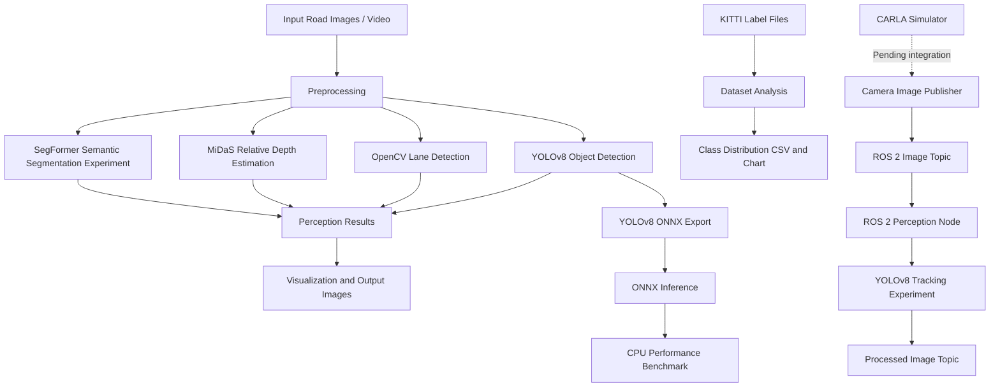

# Autonomous Driving Perception Stack – Architecture

## System Architecture

## Architecture Components

| Component | Technology | Purpose |
|---|---|---|
| Input | Images / Video | Provides road-scene data |
| Object Detection | YOLOv8 | Detects road objects |
| Lane Detection | OpenCV | Identifies lane markings |
| Depth Estimation | MiDaS | Estimates relative depth |
| Semantic Segmentation | SegFormer | Performs pixel-level classification |
| Dataset Analysis | KITTI, Pandas | Analyzes object-class distribution |
| Object Tracking | ByteTrack | Tracks detected objects |
| Communication | ROS 2 | Transfers raw and processed images |
| Model Export | ONNX | Exports and tests the detection model |
| Benchmarking | PyTorch, ONNX | Compares CPU inference performance |
| Simulation | CARLA | Planned simulator integration |

## Data Flow

1. Road images or video are provided as input.
2. Input images are processed by the perception modules.
3. YOLOv8 performs object detection.
4. OpenCV performs lane-detection operations.
5. MiDaS generates relative depth maps.
6. SegFormer performs a separate semantic-segmentation experiment.
7. Results are visualized and saved.
8. ROS 2 handles raw and processed image communication.
9. YOLOv8 is exported to ONNX and benchmarked.
10. KITTI labels are analyzed separately to understand object-class distribution.

## Current Integration Status

- Image-based perception pipeline: Implemented and tested.
- KITTI label analysis: Implemented and tested.
- ROS 2 image communication: Tested independently.
- ONNX export and inference: Tested.
- CARLA simulator integration: Pending.
- TensorRT optimization: Pending.

**Note:** This architecture represents the implemented experiments and planned integrations. It does not represent a fully deployed autonomous vehicle system.
